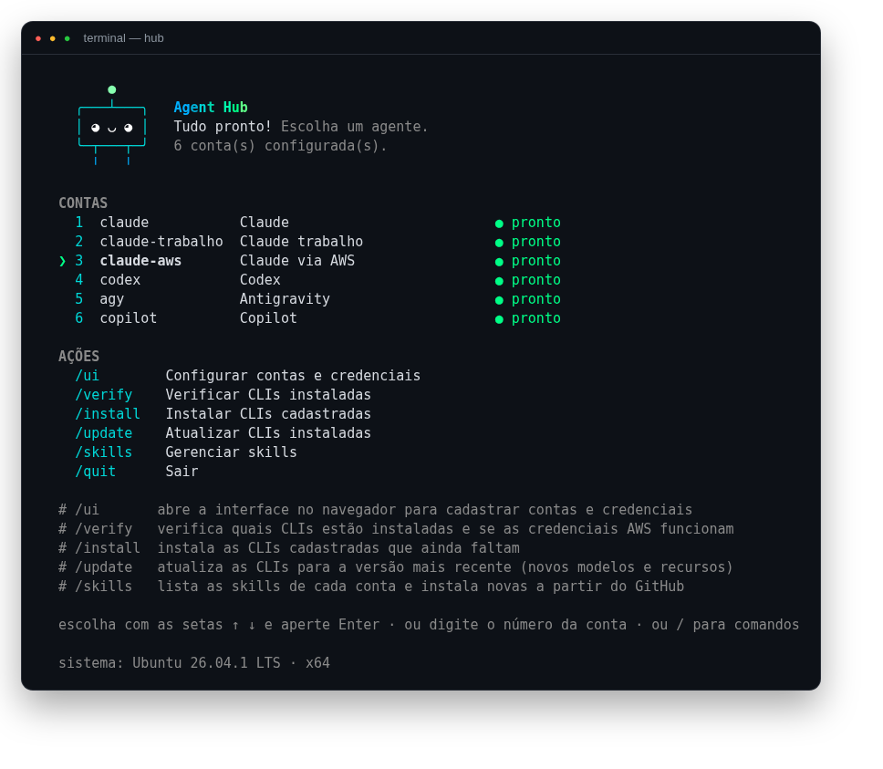
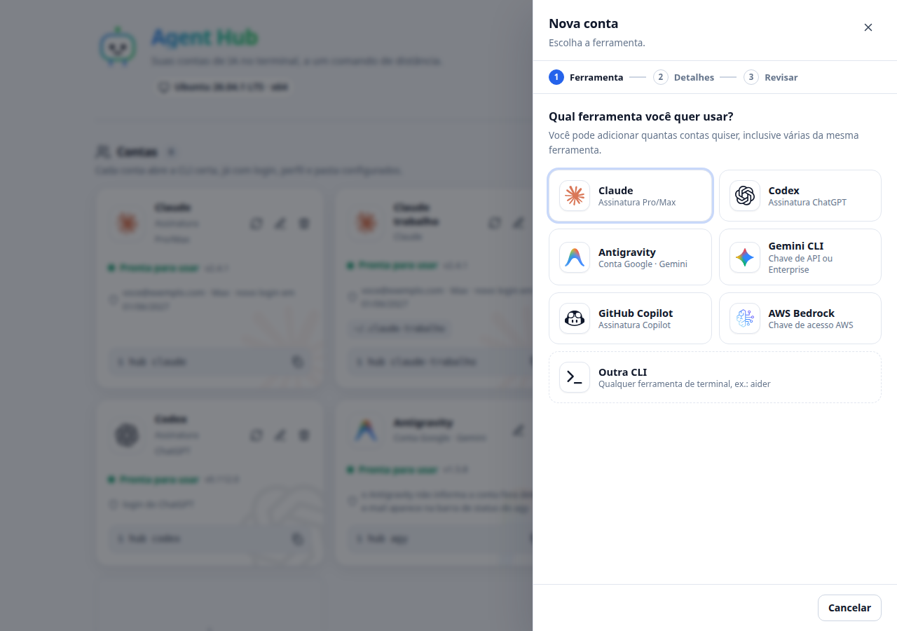
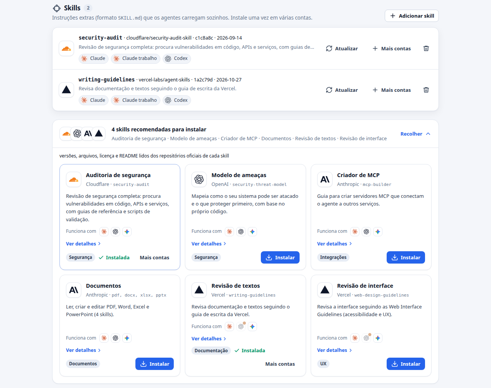
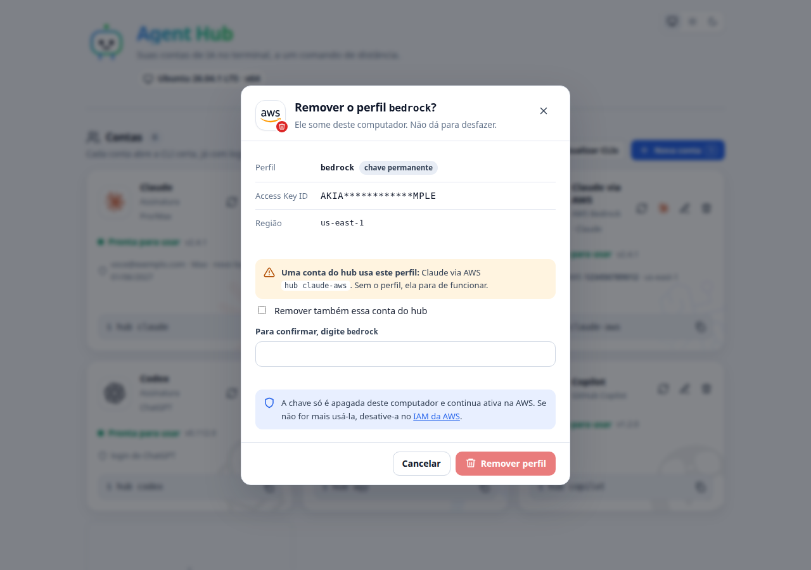

<div align="center">


# Agent Hub

**Todas as suas contas de IA no terminal, a um comando de distância.**

Claude, Claude via AWS Bedrock, Codex, Antigravity (Gemini), Gemini CLI e GitHub Copilot, cada uma já com o login certo.
Escolha no menu, use, saia e volte para o menu.



</div>

---

## Por que usar

- **Várias contas, zero confusão.** Assinatura pessoal, conta do trabalho e Bedrock lado a lado, cada uma com sua pasta de login.
- **Um comando por conta.** `hub claude`, `hub codex`, `hub claude-aws`… ou só `hub` para escolher no menu.
- **Login cuidado por você.** Cada conta mostra quem está logado (e o plano, quando a ferramenta informa). O hub avisa quando o login está para vencer e abre o login oficial antes de entrar.
- **Interface bonita para configurar.** Nada de editar arquivo à mão.
- **Skills em um clique.** Instale skills (`SKILL.md`) em várias contas de uma vez, sempre na versão mais recente.
- **Instruções e limpeza.** Uma instrução sua vira comando `/nome` em todas as LLMs; e o lixo de cada IA aparece com motivo e tamanho, pronto para limpar.
- **Sempre atualizado.** As CLIs são instaladas e atualizadas no `@latest`, e o próprio hub se atualiza sozinho.

## Instalação

Você precisa de [Node.js](https://nodejs.org) 18 ou mais novo e `git`. O [AWS CLI](https://aws.amazon.com/cli/) só é necessário para contas Bedrock.
Funciona no Linux, no macOS (inclusive com o bash antigo que vem no sistema), no WSL e no Windows nativo.

**Linux, macOS e WSL**

```bash
git clone https://github.com/SEU-USUARIO/agent-hub.git   # URL deste repositório (botão "Code" no GitHub)
cd agent-hub
./install.sh
```

**Windows (PowerShell)**

```powershell
git clone https://github.com/SEU-USUARIO/agent-hub.git   # URL deste repositório (botão "Code" no GitHub)
cd agent-hub
.\install.ps1
```

Se o Windows recusar o script, rode `powershell -ExecutionPolicy Bypass -File .\install.ps1`. O instalador cria o comando em `%USERPROFILE%\.local\bin\hub.cmd` e coloca essa pasta no PATH do seu usuário.

Pronto: digite `hub`. Se o instalador avisar que mexeu no seu PATH, abra um terminal novo antes.

## Como usar

### 1. Abra o hub

```bash
hub
```

Na primeira vez, o hub procura as contas que você **já usa** nesta máquina e oferece adicioná-las:


### 2. Adicione contas pela interface

Digite `/ui` no menu (ou `hub ui`). A interface abre no navegador:


Clique em **Nova conta** e siga os 3 passos: ferramenta, detalhes e revisão:

<table>
<tr>
<td></td>
<td></td>
</tr>
</table>

Quer duas contas da mesma ferramenta? Marque **Separar o login desta conta** e cada uma terá seu próprio login.

Enquanto a interface está aberta, o terminal mostra o endereço; aperte `q` para voltar ao menu:


### 3. Escolha uma conta e trabalhe

No menu, use **↑ ↓ + Enter** ou digite o número da conta. Ao sair da CLI, você volta para o menu.

Também dá para ir direto: `hub claude-aws`. Argumentos extras vão para a CLI: `hub claude --continue`.

## Comandos do menu

| Comando | O que faz |
|---|---|
| `/ui` | abre a interface no navegador |
| `/verify` | confere quais CLIs estão instaladas e se as credenciais AWS funcionam |
| `/install` | instala as CLIs cadastradas que faltam |
| `/update` | atualiza as CLIs para a versão mais recente |
| `/skills` | lista e instala skills a partir do GitHub |
| `/quit` | sai (ou `Esc`) |

Basta o começo do comando: `/in` vira `/install`, e o Tab completa.

## Instruções

Instruções são textos em Markdown que a LLM segue em **qualquer repositório**, como um passo a passo para revisar tarefas. Na seção **Instruções**, cole o texto, escolha como aplicar e em quais LLMs:

- **Comando `/nome`** (padrão): vira uma skill que você dispara quando quiser (`/nome` no Claude, Gemini, Copilot e Antigravity; `$nome` no Codex), criada em `skills/<nome>/SKILL.md` de cada LLM.
- **Sempre ativa:** a LLM segue em toda conversa, sem você pedir. Vai para o arquivo global de cada uma (tabela abaixo).
- **Ambos.**

Arquivos globais da opção "sempre ativa":

| LLM | Arquivo |
|---|---|
| Claude (inclusive via Bedrock) | `CLAUDE.md` na pasta da conta (ex.: `~/.claude/CLAUDE.md`) |
| Codex | `~/.codex/AGENTS.md` (ou `AGENTS.override.md`, se ele existir) |
| Gemini CLI | `~/.gemini/GEMINI.md` (ou o nome definido em `context.fileName`) |
| Antigravity | `~/.gemini/config/AGENTS.md`, que só ele lê (até 24 KB) |
| Copilot | `~/.copilot/copilot-instructions.md` |

Cada instrução fica entre marcadores, então o hub edita e remove só o que é dele. O resto do arquivo não muda, e uma cópia fica em `.bak`. O que já existia nesses arquivos (inclusive `~/.claude/rules/` e `~/.copilot/instructions/`) aparece em **Já existiam**, com a opção de aplicar em outras LLMs.


## Skills

Skills são instruções extras (`SKILL.md`) que os agentes carregam sozinhos: auditoria de segurança, documentos do Office, revisão de textos e outras.



- **Sugestões prontas** de fontes oficiais (Cloudflare, OpenAI, Anthropic, Vercel), ou cole qualquer repositório do GitHub.
- **Sempre a versão mais recente**, baixada na hora do repositório oficial.
- **Dependências conferidas antes**: pacotes Python e Node o hub instala sozinho; programas do sistema ele instala pelo Homebrew no macOS ou mostra o comando `apt` no Linux.
- **Mais contas**: leve uma skill instalada para outras contas com um clique.
- **Use direto pelo hub**: `hub skill <nome>` (ou o número da skill em `/skills`) abre a CLI da conta já rodando a skill.

Clique em uma skill para ver resumo, licença, versão e com quais modelos ela funciona:


## AWS Bedrock

Cadastre o perfil AWS pela própria interface (ou use um perfil que já existe em `~/.aws`). As chaves aparecem mascaradas e só dentro de um modal, e dá para testar a conexão com um clique:


Se o perfil usa SSO e a sessão venceu, o hub roda `aws sso login` antes de abrir a conta.

**Modelos sempre atualizados:** no Bedrock, o Claude Code só usa um modelo novo (ex.: um Fable ou Sonnet que acabou de sair) se o ID dele estiver fixado no `settings.json` da conta. No card da conta Bedrock, o botão de modelos consulta a AWS (`aws bedrock list-inference-profiles`) com o perfil e a região da conta, mostra o que está fixado e o mais recente disponível de cada família (Fable, Opus, Sonnet, Haiku) e atualiza com um clique. Só as variáveis `ANTHROPIC_DEFAULT_*_MODEL` mudam, mantendo o resto do arquivo e uma cópia em `settings.json.bak`. O `/update` do terminal faz o mesmo.

Para remover um perfil, use a lixeira ao lado dele: o hub apaga a seção dele em `~/.aws/credentials` e `~/.aws/config`, sem tocar nos outros. Se alguma conta do hub usa o perfil, ele avisa e pede que você digite o nome para confirmar:



## Gemini e Antigravity

Desde 18/06/2026, o Google não aceita mais login com conta Google pessoal (gratuita, AI Pro ou Ultra) no Gemini CLI: só chave paga da API do Gemini ou licença Enterprise. Para usar o Gemini com a sua conta Google, adicione o **Antigravity** (comando `agy`): o hub instala pelo script oficial e, na primeira vez, ele abre o login do Google no navegador. Dentro dele, `/model` troca entre Gemini 4, Claude e outros.

Se você ainda tem uma conta Gemini com login pessoal, o hub mostra **Login bloqueado pelo Google** e oferece adicionar o Antigravity.

## Limpeza

A seção **Limpeza** tem duas partes.

**Lixo encontrado:** para cada IA instalada, um card com o que é lixo de verdade, o que cada item é e quanto ocupa. Só entra o que pode sair com a ferramenta instalada e logada: caches, logs, arquivos temporários, versões antigas que já não rodam (ex.: releases antigas do daemon do Codex, uma instalação nativa antiga do Claude Code, uma cópia duplicada do npm que perde no PATH), conversas mais antigas do que o próprio Claude Code já descartaria e sobras do hub. Login, configurações, skills e conversas recentes nunca entram, e só são analisadas as pastas das próprias ferramentas (links e pastas comuns como `~/projetos` ficam de fora). **Limpar lixo** abre a confirmação com cada item, o motivo, o caminho e o tamanho; itens que precisam da ferramenta fechada vêm desmarcados, e os que precisam de sudo mostram o comando.

**Ferramentas sem conta e pastas antigas:** desinstalar por completo uma CLI que nenhuma conta usa (com os dados dela) ou apagar pastas de contas que não existem mais, sempre digitando o nome para confirmar. Pastas compartilhadas (`~/.agents`, `~/.gemini/skills`, `GEMINI.md`, as do Antigravity) nunca são apagadas.


## Seus dados

- **Sistema detectado automaticamente.** O instalador e o hub identificam o sistema (Linux, macOS, Windows ou WSL) antes de qualquer ação, e tudo é instalado e gravado no padrão dele. O sistema aparece no menu, no `/verify` e no topo da interface. Clicando nele, você vê onde cada coisa é gravada.
- **Nenhuma senha ou token fica no hub.** O arquivo `~/.config/hub/config` guarda só qual CLI, pasta de login e perfil AWS cada conta usa.
- Os logins continuam nas pastas de cada ferramenta (`~/.claude`, `~/.codex`, …) e as chaves AWS em `~/.aws`, gerenciadas pelo AWS CLI.
- A interface roda só no seu computador (`127.0.0.1`), com um token novo a cada abertura, e nunca envia chaves completas para a página: chaves AWS e variáveis como `GEMINI_API_KEY` ou `GH_TOKEN` aparecem mascaradas.
- O config do hub é gravado só para o seu usuário (permissão 600), e quem tem acesso a ele pode rodar comandos como você: o campo `install` de cada conta é executado no terminal. Use só comandos de fonte confiável.
- Skills vêm de repositórios do GitHub que você escolhe: o hub mostra a origem e a versão antes de instalar e não copia links que apontem para fora da skill.

## Atualizações

Ao abrir, o hub confere se existe versão nova no repositório de onde você clonou e pergunta se quer atualizar.
Se você tiver alterações locais, ele não atualiza por cima e mostra o comando para fazer à mão.
Não quer a checagem? Use `HUB_NO_UPDATE=1 hub`.

As CLIs são atualizadas com `/update` (ou o botão **Atualizar CLIs** na interface), sempre para a versão mais recente.

<details>
<summary><b>Mais detalhes</b></summary>

- **Outras CLIs:** em **Nova conta → Outra CLI**, informe o comando (ex.: `aider`) e, se quiser, o comando de instalação.
- **Config à mão:** veja `config.example`. Cada conta é uma seção `[nome]` com `type`, `label`, `command`, `args`, `env` e `install`. Comentários e chaves extras são mantidos quando você salva pela interface.
- **Modelos (LLMs) por skill:** lidos das páginas oficiais (Anthropic, OpenAI, Google, Antigravity, GitHub) e guardados em `~/.config/hub/agent-models.json`; só o que mudou é regravado.
- **Pastas de skills:** `~/.claude/skills`, `~/.codex/skills`, `~/.gemini/skills`, `~/.gemini/antigravity-cli/skills`, `~/.copilot/skills` e `~/.agents/skills` (ou as pastas de login separadas de cada conta).
- **Instalar sem animação:** `HUB_FAST=1 ./install.sh`.
- **Desinstalar:** `./install.sh --uninstall` (no Windows: `.\install.ps1 -Uninstall`).

</details>

## Licença

MIT; o titular do copyright está em `LICENSE`. Os logotipos das ferramentas vêm do [LobeHub Icons](https://github.com/lobehub/lobe-icons) (MIT) e as marcas pertencem às respectivas empresas; detalhes em `NOTICE.md`.
