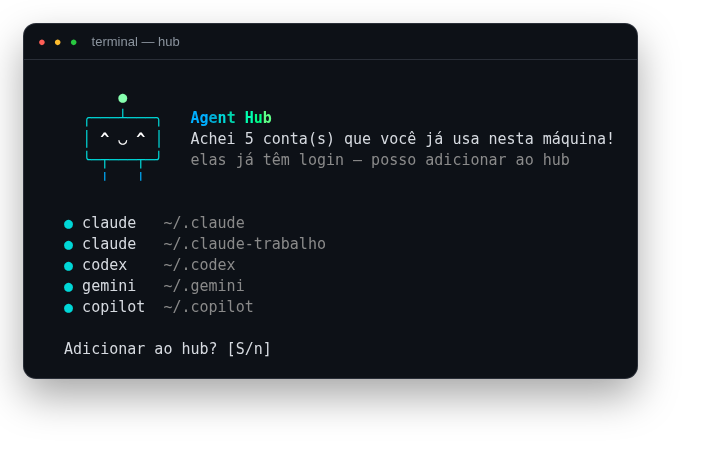
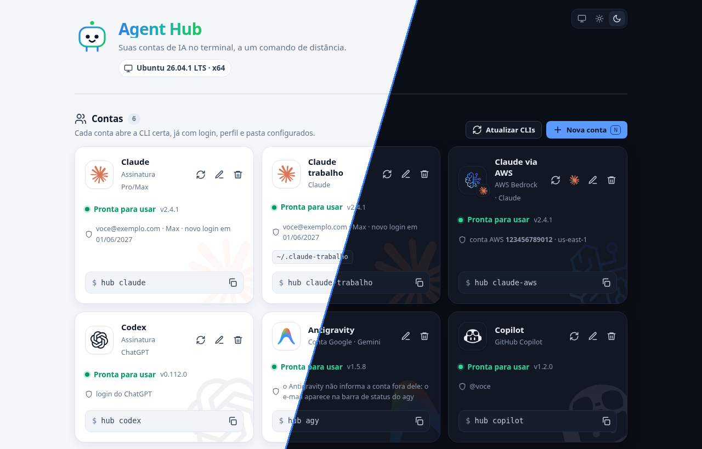
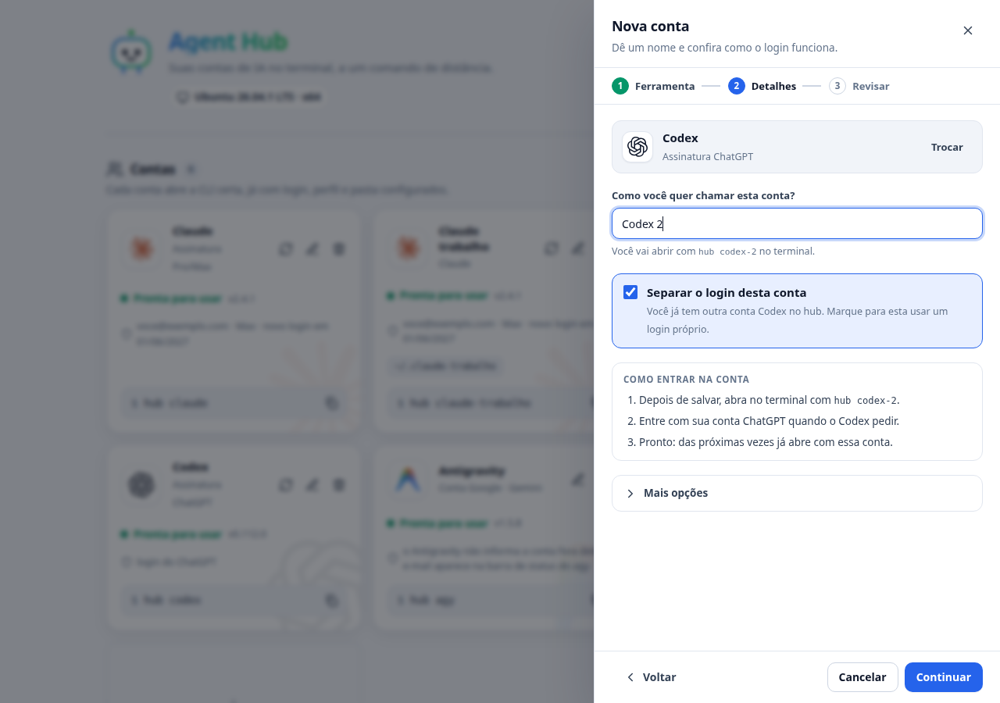
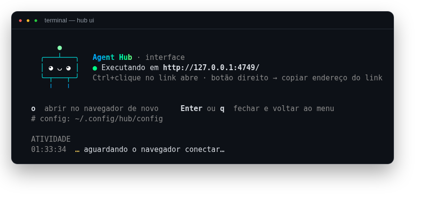
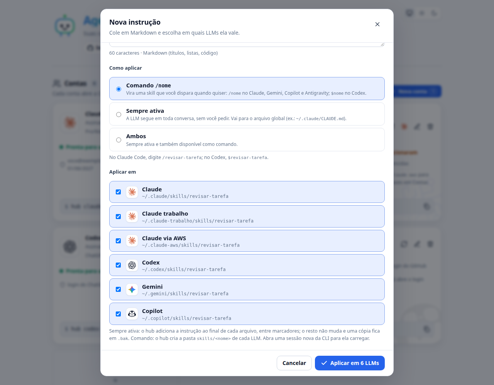
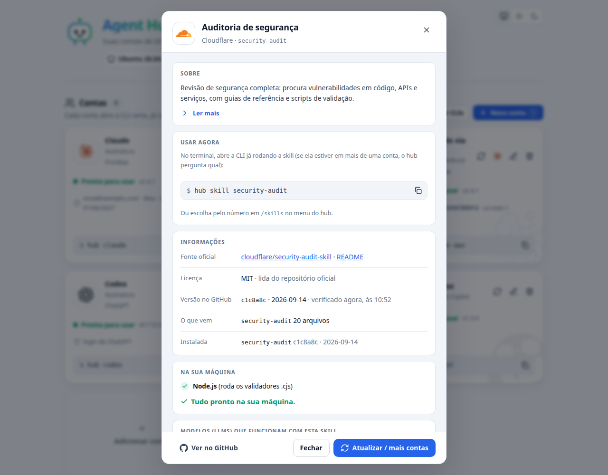
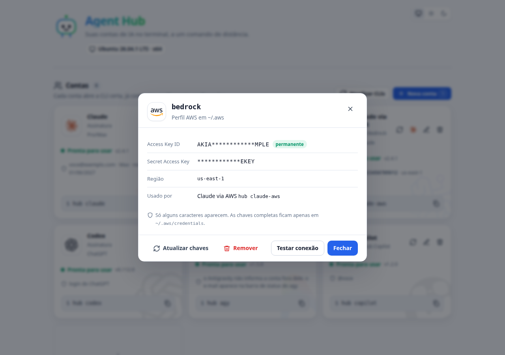
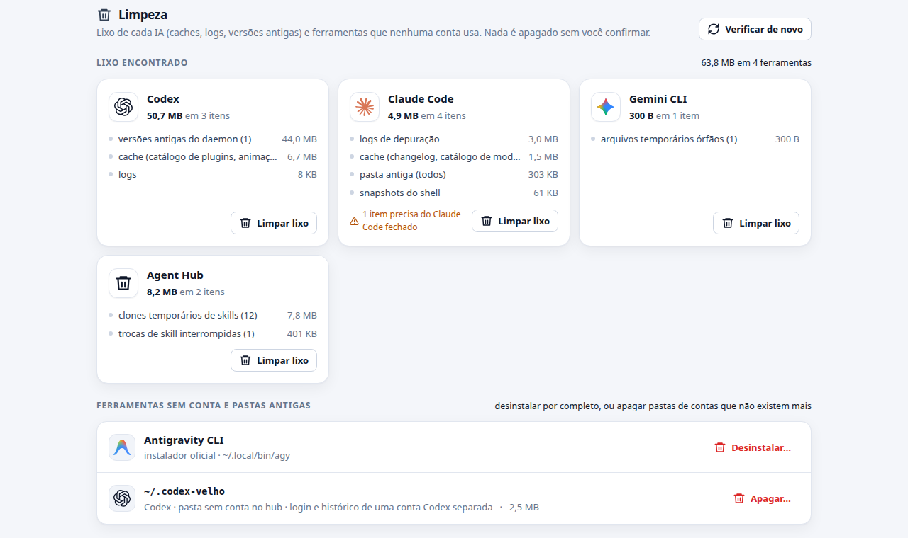

<div align="center">


# Agent Hub

**Todas as suas contas de IA no terminal, a um comando de distância.**

Claude, Claude via AWS Bedrock, Codex, Antigravity (Gemini), Gemini CLI e GitHub Copilot, cada uma já com o login certo.
Escolha no menu, use, saia e volte para o menu.


</div>

---

## Por que usar

- **Várias contas, zero confusão.** Assinatura pessoal, conta do trabalho e Bedrock lado a lado, cada uma com sua pasta de login.
- **Um comando por conta.** `hub claude`, `hub codex`, `hub claude-aws`… ou só `hub` para escolher no menu.
- **Login cuidado por você.** Cada conta mostra quem está logado (e o plano, quando a ferramenta informa). O hub avisa quando o login está para vencer e abre o login oficial antes de entrar.
- **Interface bonita para configurar.** Nada de editar arquivo à mão.
- **Skills em um clique.** Instale skills (`SKILL.md`) em várias contas de uma vez, sempre na versão mais recente.
- **Instruções e limpeza.** Uma instrução sua vira comando `/nome` em todas as LLMs; e o lixo de cada IA aparece com motivo e tamanho, pronto para limpar.
- **Sempre atualizado.** As CLIs são instaladas e atualizadas no `@latest`, e o próprio hub se atualiza sozinho.

## Instalação

Você precisa de [Node.js](https://nodejs.org) 18 ou mais novo e `git`; se faltarem, o instalador oferece instalá-los. O [AWS CLI](https://aws.amazon.com/cli/) só é necessário para contas Bedrock.
Funciona no Linux, no macOS (inclusive com o bash antigo que vem no sistema), no WSL e no Windows nativo.

**Linux, macOS e WSL**

```bash
git clone https://github.com/SEU-USUARIO/agent-hub.git   # URL deste repositório (botão "Code" no GitHub)
cd agent-hub
./install.sh
```

**Windows (PowerShell)**

```powershell
git clone https://github.com/SEU-USUARIO/agent-hub.git   # URL deste repositório (botão "Code" no GitHub)
cd agent-hub
.\install.ps1
```

Se o Windows recusar o script, rode `powershell -ExecutionPolicy Bypass -File .\install.ps1`. O instalador cria o comando em `%USERPROFILE%\.local\bin\hub.cmd` e coloca essa pasta no PATH do seu usuário.

Pronto: digite `hub`. Se o instalador avisar que mexeu no seu PATH, abra um terminal novo antes.

## Como usar

### 1. Abra o hub

```bash
hub
```

Na primeira vez, o hub procura as contas que você **já usa** nesta máquina e oferece adicioná-las:



### 2. Adicione contas pela interface

Digite `/ui` no menu (ou `hub ui`). A interface abre no navegador:



Clique em **Nova conta** e siga os 3 passos: ferramenta, detalhes e revisão:

<table>
<tr>
<td></td>
<td></td>
</tr>
</table>

Quer duas contas da mesma ferramenta? É só adicionar a segunda: quando já existe uma conta dela no hub (no Claude, vale tanto assinatura quanto AWS Bedrock), a nova já recebe uma pasta de login própria, sem nada para marcar. Para escolher outra pasta, use **Mais opções → Pasta do login**.

Enquanto a interface está aberta, o terminal mostra o endereço; aperte `q` para voltar ao menu:



### 3. Escolha uma conta e trabalhe

No menu, use **↑ ↓ + Enter** ou digite o número da conta. Ao sair da CLI, você volta para o menu.

Também dá para ir direto: `hub claude-aws`. Argumentos extras vão para a CLI: `hub claude --continue`.

Para abrir sempre com os mesmos argumentos, edite a conta na interface e use o bloco **Ao abrir**: marque uma opção (ex.: **Liberar todas as permissões**, que no Claude vira `--dangerously-skip-permissions`) ou digite os argumentos. O card da conta mostra o aviso "permissões liberadas" quando uma dessas opções está ligada.

Cada CLI tem o seu argumento para a mesma função, e o hub mostra só os que valem para ela:

| Função | Claude Code | Codex | Gemini CLI | Antigravity | Copilot CLI |
|---|---|---|---|---|---|
| Liberar todas as permissões | `--dangerously-skip-permissions` | `--dangerously-bypass-approvals-and-sandbox` | `--yolo` | `--dangerously-skip-permissions` | `--allow-all` |
| Aceitar edições | `--permission-mode acceptEdits` | `--sandbox workspace-write --ask-for-approval on-request` | `--approval-mode auto_edit` | `--mode accept-edits` | `--allow-tool=write` |
| Continuar a última conversa | `--continue` | `resume --last` | `--resume latest` | `--continue` | `--continue` |
| Histórico de sessões (**→ →**) | `--resume` | `resume` | lista do hub, depois `--resume N` | só por `/resume` dentro dele | `--resume` |

As duas opções de permissão não podem ser usadas juntas: o hub desmarca uma ao marcar a outra e recusa salvar ou abrir com as duas.

Essas opções são o **padrão** da conta, mas dá para mudar só numa abertura, direto no menu do `hub`:

- Enter (ou o número) abre direto com o padrão da conta, sem perguntar nada.
- Para mudar só naquela vez, aperte **→** na conta: o hub mostra a tela **Abrir** com o padrão já marcado. Desmarque ou marque o que quiser (ex.: não liberar tudo numa pasta que você não conhece) e aperte Enter.
- Para retomar uma conversa antiga, aperte **→** na conta e **→** de novo: abre o histórico de sessões da pasta em que você abriu o hub, já com as opções marcadas.
- Na tela **Abrir**: ↑ ↓ escolhe, Espaço ou o número marca/desmarca, `0` desmarca tudo, Enter abre, → abre o histórico de sessões e ← ou Esc volta. A legenda das teclas fica sempre na tela. "Liberar todas as permissões" e "Aceitar edições de arquivo" se excluem. O que você muda ali vale só para aquela abertura, a menos que aperte **s**: aí vira o novo padrão da conta (grava no config, igual a salvar pela interface).
- No menu, a linha da conta mostra o padrão em cinza, discreto (ex.: `◆ tudo liberado · continua`).

## Comandos do menu

| Comando | O que faz |
|---|---|
| `/ui` | abre a interface no navegador |
| `/verify` | confere quais CLIs estão instaladas e se as credenciais AWS funcionam |
| `/install` | instala as CLIs cadastradas que faltam |
| `/update` | atualiza as CLIs para a versão mais recente, pelo mesmo meio em que foram instaladas, e troca os modelos fixados numa versão antiga pelo mais recente de cada conta |
| `/skills` | lista, instala e atualiza skills a partir do GitHub |
| `/quit` | sai (ou `Esc`) |

Basta o começo do comando: `/in` vira `/install`, e o Tab completa.

## Instruções

Instruções são textos em Markdown que a LLM segue em **qualquer repositório**, como um passo a passo para revisar tarefas. Na seção **Instruções**, cole o texto, escolha como aplicar e em quais LLMs:

- **Comando `/nome`** (padrão): vira uma skill que você dispara quando quiser (`/nome` no Claude, Gemini, Copilot e Antigravity; `$nome` no Codex), criada em `skills/<nome>/SKILL.md` de cada LLM.
- **Sempre ativa:** a LLM segue em toda conversa, sem você pedir. Vai para o arquivo global de cada uma (tabela abaixo).
- **Ambos.**

Arquivos globais da opção "sempre ativa":

| LLM | Arquivo |
|---|---|
| Claude (inclusive via Bedrock) | `CLAUDE.md` na pasta da conta (ex.: `~/.claude/CLAUDE.md`) |
| Codex | `~/.codex/AGENTS.md` (ou `AGENTS.override.md`, se ele existir) |
| Gemini CLI | `~/.gemini/GEMINI.md` (ou o nome definido em `context.fileName`) |
| Antigravity | `~/.gemini/config/AGENTS.md`, que só ele lê (até 24 KB) |
| Copilot | `~/.copilot/copilot-instructions.md` |

Cada instrução fica entre marcadores, então o hub edita e remove só o que é dele. O resto do arquivo não muda, e uma cópia fica em `.bak`. O que já existia nesses arquivos (inclusive `~/.claude/rules/` e `~/.copilot/instructions/`) aparece em **Já existiam**, com a opção de aplicar em outras LLMs.



## Skills

Skills são instruções extras (`SKILL.md`) que os agentes carregam sozinhos: auditoria de segurança, documentos do Office, revisão de textos e outras.


- **Sugestões prontas** de fontes oficiais (Cloudflare, OpenAI, Anthropic, Vercel), ou cole qualquer repositório do GitHub: `dono/repositório`, `dono/repositório@branch`, o link do GitHub (https ou SSH, inclusive de uma pasta ou branch específica), um link do skills.sh ou a linha `npx skills add …`. A branch do link é respeitada na instalação e nas atualizações seguintes.
- **Sempre a versão mais recente**, baixada na hora do repositório oficial.
- **Dependências conferidas antes**: pacotes Python e Node o hub instala sozinho (se o npm global for do root, mostra o comando com `sudo`); programas do sistema ele instala pelo Homebrew no macOS, pelo `apt`, `dnf`, `zypper`, `yum`, `pacman` ou `apk` no Linux (o terminal roda com sudo; a interface mostra o comando) e pelo `winget` no Windows.
- **Repositórios fora do catálogo**: o hub deduz as dependências pelos arquivos da própria skill (`requirements.txt`, `pyproject.toml`, `package.json`, imports dos scripts Python e Node, comandos `pip`, `npm -g`, `brew` e `apt` citados no SKILL.md, o campo `dependencies` do cabeçalho e programas conhecidos que os scripts chamam, como LibreOffice, pandoc, poppler, ffmpeg e Tesseract) e mostra a evidência de cada uma. Versões pedidas no `requirements.txt` são respeitadas, e se a skill traz um `package.json` com dependências o hub roda `npm install` na pasta dela ao instalar (sem scripts de pós-instalação). Esse passo só é automático quando os pacotes vêm do registro do npm e a skill não traz um `.npmrc` próprio: com `.npmrc`, `workspaces` ou dependências de git, URL ou pasta local, o hub avisa e deixa o `npm install` para você, depois de conferir a skill. Também lê a licença e o campo `compatibility` do SKILL.md, exibe um trecho do README e lista os passos que o SKILL.md pede e o hub não faz sozinho, como variáveis de ambiente e comandos de setup. A tabela curada do hub só vale para a skill do catálogo vinda do repositório oficial; uma pasta de mesmo nome em outro repositório é analisada pelos próprios arquivos.
- **Aviso de versão nova**: a interface confere o GitHub em segundo plano e marca as skills cujo repositório mudou; **Atualizar N skills** baixa todas de uma vez. No terminal: `hub skills update` (ou a opção "Atualizar as skills instaladas" em `/skills`).
- **Suas edições ficam protegidas**: se você mudou uma skill na sua máquina depois de instalar, o hub avisa e só sobrescreve com a sua confirmação.
- **Mais contas**: leve uma skill instalada para outras contas com um clique.
- **Use direto pelo hub**: `hub skill <nome>` (ou o número da skill em `/skills`) abre a CLI da conta já rodando a skill.

Clique em uma skill para ver resumo, licença, versão e com quais modelos ela funciona:



## AWS Bedrock

Cadastre o perfil AWS pela própria interface (ou use um perfil que já existe em `~/.aws`). As chaves aparecem mascaradas e só dentro de um modal, e dá para testar a conexão com um clique:



Se o perfil usa SSO e a sessão venceu, o hub roda `aws sso login` antes de abrir a conta.

**Bedrock detectado onde estiver:** o hub reconhece uma conta como Bedrock quando `CLAUDE_CODE_USE_BEDROCK=1` está no `env` da conta, no `settings.json` da pasta de login ou no ambiente do shell, na mesma ordem que o Claude Code usa. Região e perfil AWS seguem a mesma regra. O card mostra de onde veio ("Bedrock via settings.json") quando não está no config do hub.

**Modelos sempre atualizados:** no Bedrock, o Claude Code só usa um modelo novo (ex.: um Fable ou Sonnet que acabou de sair) se o ID dele estiver fixado no `settings.json` da conta. No card da conta Bedrock, o botão de modelos consulta a AWS (`aws bedrock list-inference-profiles`) com o perfil e a região da conta, mostra o que está fixado e o mais recente disponível de cada família (Fable, Opus, Sonnet, Haiku) e atualiza com um clique. Só as variáveis `ANTHROPIC_DEFAULT_*_MODEL` mudam, mantendo o resto do arquivo e uma cópia em `settings.json.bak`. O `/update` do terminal faz o mesmo. O prefixo que você já usa (`global.`, `us.`, `eu.`…) é preservado quando a versão nova existe com ele. IDs fixados pela organização no `managed-settings.json` (em `/etc/claude-code` no Linux, `/Library/Application Support/ClaudeCode` no macOS ou `%ProgramData%\ClaudeCode` no Windows) têm prioridade e o hub não os altera, só avisa. Ao abrir uma conta Bedrock pelo terminal, o hub confere uma vez por dia se há modelo novo e avisa; a troca fica para o `/update`.

Para remover um perfil, use a lixeira ao lado dele: o hub apaga a seção dele em `~/.aws/credentials` e `~/.aws/config`, sem tocar nos outros. Se alguma conta do hub usa o perfil, ele avisa e pede que você digite o nome para confirmar:


## Gemini e Antigravity

Desde 18/06/2026, o Google não aceita mais login com conta Google pessoal (gratuita, AI Pro ou Ultra) no Gemini CLI: só chave paga da API do Gemini ou licença Enterprise. Para usar o Gemini com a sua conta Google, adicione o **Antigravity** (comando `agy`): o hub instala pelo script oficial e, na primeira vez, ele abre o login do Google no navegador. Dentro dele, `/model` troca entre Gemini 4, Claude e outros.

Se você ainda tem uma conta Gemini com login pessoal, o hub mostra **Login bloqueado pelo Google** e oferece adicionar o Antigravity.

## Limpeza

A seção **Limpeza** tem duas partes.

**Lixo encontrado:** para cada IA instalada, um card com o que é lixo de verdade, o que cada item é e quanto ocupa. Só entra o que pode sair com a ferramenta instalada e logada: caches, logs, arquivos temporários, versões antigas que já não rodam (ex.: releases antigas do daemon do Codex, uma instalação nativa antiga do Claude Code, uma cópia duplicada do npm que perde no PATH), conversas mais antigas do que o próprio Claude Code já descartaria e sobras do hub. Login, configurações, skills e conversas recentes nunca entram, e só são analisadas as pastas das próprias ferramentas (links e pastas comuns como `~/projetos` ficam de fora). **Limpar lixo** abre a confirmação com cada item, o motivo, o caminho e o tamanho; itens que precisam da ferramenta fechada vêm desmarcados, e os que precisam de sudo mostram o comando.

**Ferramentas sem conta e pastas antigas:** desinstalar por completo uma CLI que nenhuma conta usa (com os dados dela) ou apagar pastas de contas que não existem mais, sempre digitando o nome para confirmar. Pastas compartilhadas (`~/.agents`, `~/.gemini/skills`, `GEMINI.md`, as do Antigravity) nunca são apagadas.



## Desinstalar

Dois níveis, sempre rodando dentro da pasta do projeto:

- **Só o comando `hub`:** `./uninstall.sh` (Windows: `.\uninstall.ps1`). Suas contas em `~/.config/hub` ficam, para o caso de instalar de novo.
- **Tudo do hub:** `./uninstall.sh --all` (Windows: `.\uninstall.ps1 -All`). Mostra a lista, pede confirmação e remove o comando, as contas e dados do hub e a linha de PATH que o instalador criou. No final, mostra o comando para apagar a pasta do projeto.

Nos dois níveis, as CLIs, seus logins, skills e instruções continuam onde estão: eles funcionam sem o hub.

## Seus dados

- **Sistema detectado automaticamente.** O instalador e o hub identificam o sistema (Linux, macOS, Windows ou WSL) antes de qualquer ação, e tudo é instalado e gravado no padrão dele. O sistema aparece no menu, no `/verify` e no topo da interface. Clicando nele, você vê onde cada coisa é gravada.
- **Nenhuma senha ou token fica no hub.** O arquivo `~/.config/hub/config` guarda só qual CLI, pasta de login e perfil AWS cada conta usa.
- Os logins continuam nas pastas de cada ferramenta (`~/.claude`, `~/.codex`, …) e as chaves AWS em `~/.aws`, gerenciadas pelo AWS CLI.
- A interface roda só no seu computador (`127.0.0.1`), com um token novo a cada abertura, e nunca envia chaves completas para a página: chaves AWS e variáveis como `GEMINI_API_KEY` ou `GH_TOKEN` aparecem mascaradas.
- O config do hub é gravado só para o seu usuário (permissão 600), e quem tem acesso a ele pode rodar comandos como você: o campo `install` de cada conta é executado no terminal. Use só comandos de fonte confiável.
- Skills vêm de repositórios do GitHub que você escolhe: o hub mostra a origem e a versão antes de instalar e não copia links que apontem para fora da skill, nem links que passem por outro link.
- O navegador é aberto com um link de uso único, que vale 1 minuto (demorou? aperte `o` de novo) e é cancelado se o navegador não abrir. No Linux, a interface só atende conexões do seu próprio usuário; as recusadas aparecem na lista de atividade do terminal. Se você acessa a interface por um túnel ou proxy que roda como outro usuário, use `HUB_UI_ANY_USER=1 hub` para desligar essa conferência.

## Atualizações

Ao abrir, o hub confere se existe versão nova no repositório de onde você clonou e pergunta se quer atualizar.
Se você tiver alterações locais, ele não atualiza por cima e mostra o comando para fazer à mão.
Não quer a checagem? Use `HUB_NO_UPDATE=1 hub`.

As CLIs são atualizadas com `/update` (ou o botão **Atualizar versões das CLIs** na interface), sempre para a versão mais recente. O botão **Atualizar**, ao lado, não instala nada: só confere de novo o login e o status de cada conta, as versões instaladas e se há conta nova na máquina ainda fora do hub.

Junto com as CLIs, os dois também atualizam os **modelos fixados** de todas as contas: um ID preso numa versão antiga (ex.: `claude-fable-5-1` no `settings.json`, `model = "gpt-5.5"` no `config.toml` do Codex, `gemini-3.5-flash` no Gemini CLI) vai para o mais recente da mesma família, consultado na fonte oficial de cada ferramenta (documentação da Anthropic, repositórios `openai/codex` e `google-gemini/gemini-cli`, e a própria conta AWS no Bedrock). Apelidos (`opus`, `sonnet`…) e contas sem modelo fixado não mudam, porque já acompanham a CLI. No Copilot o hub só avisa, e a troca é pelo `/model`. Cada arquivo alterado ganha uma cópia `.bak`, e a interface mostra um resumo do que mudou em cada CLI e em cada conta.

O hub olha onde cada CLI está instalada e atualiza pelo mesmo meio, em vez de assumir npm para tudo. `/verify` e o card da conta mostram o meio detectado (ex.: "via instalador oficial"):

| Meio | Como o hub detecta | Como atualiza |
|---|---|---|
| npm (inclusive nvm, fnm, Volta) | o executável aponta para `node_modules` | `npm install -g pacote@latest` |
| pnpm, Yarn, Bun | pasta global do gerenciador | `pnpm add -g`, `yarn global add`, `bun add -g` |
| Homebrew | `Cellar` ou `Caskroom` | `brew upgrade` (casks `claude-code`, `codex`, `copilot-cli`; fórmula `gemini-cli`) |
| Instalador oficial | `~/.local/bin` (Claude, Copilot, Antigravity) | `claude update`; Copilot roda o instalador de novo; Antigravity se atualiza sozinho |
| winget | pasta do WinGet | `winget upgrade --id …` (Claude, Codex e Copilot) |
| Binário avulso | qualquer outro lugar | mostra onde está e onde baixar a versão nova |

Para quem ainda não tem a CLI, o hub tenta os meios disponíveis na máquina, em ordem, e passa para o próximo se um falhar: instalador oficial primeiro no Claude (não depende do Node), npm primeiro nas demais, depois Homebrew e winget. O campo `install` do config sempre tem prioridade sobre a detecção.

O que o `/install` e o `/update` resolvem sozinhos:

| Problema | O que o hub faz |
|---|---|
| Node antigo para o pacote (ex.: `claude-code` exige Node 22) | consulta a exigência no registro do npm e usa um meio que não depende do Node; numa CLI já instalada pelo npm, migra para o instalador oficial e remove a antiga |
| Sobra de instalação interrompida (`ENOTEMPTY`), arquivo no lugar do executável (`EEXIST`), cache corrompido (`EINTEGRITY`) | limpa e tenta de novo |
| Queda de rede no meio do download, Homebrew ocupado | espera e tenta de novo |
| npm global do root numa instalação nova | instala em `~/.local`, sem `sudo` |
| CLI instalada em outro prefixo do npm | atualiza no mesmo prefixo |
| Falta `curl`, `bash` ou, no Alpine, as bibliotecas do Claude | instala pelo gerenciador de pacotes do sistema (pede a senha do `sudo` no terminal) |
| CLI instalada fora do PATH do terminal aberto | passa a enxergar `~/.local/bin`, a pasta do npm, do Homebrew e do winget na hora |
| winget sem atualização disponível ou perguntando sobre os termos | trata como sucesso e aceita os termos |

Depois de instalar, o hub confere se o executável abre; se não abrir, diz o motivo (glibc antiga, biblioteca faltando, arquitetura errada, Node antigo). O que ele não resolve sozinho vem com o comando para rodar: atualizar uma CLI de um npm global do root (o terminal usa `sudo`; a interface mostra o comando), disco cheio, certificado de proxy corporativo e Node antigo quando a CLI só existe no npm.

Os instaladores do hub (`install.sh` e `install.ps1`) também oferecem instalar o Node.js LTS (Homebrew, nvm ou winget) e o git quando faltam.

<details>
<summary><b>Mais detalhes</b></summary>

- **Outras CLIs:** em **Nova conta → Outra CLI**, informe o comando (ex.: `aider`) e, se quiser, o comando de instalação.
- **Config à mão:** veja `config.example`. Cada conta é uma seção `[nome]` com `type`, `label`, `command`, `args`, `env` e `install`. Comentários e chaves extras são mantidos quando você salva pela interface.
- **Modelos (LLMs) por skill:** lidos das páginas oficiais (Anthropic, OpenAI, Google, Antigravity, GitHub) e guardados em `~/.config/hub/agent-models.json`; só o que mudou é regravado.
- **Pastas de skills:** `~/.claude/skills`, `~/.codex/skills`, `~/.gemini/skills`, `~/.gemini/antigravity-cli/skills`, `~/.copilot/skills` e `~/.agents/skills` (ou as pastas de login separadas de cada conta).
- **Instalar sem animação:** `HUB_FAST=1 ./install.sh`.

</details>

## Testes

Os testes das proteções de segurança (instalação de skills, links, abertura da interface, limpeza, modelos do Codex) rodam com o próprio Node, sem instalar nada, numa pasta temporária:

```bash
node --test test/
```

## Licença

MIT; o titular do copyright está em `LICENSE`. Os logotipos das ferramentas vêm do [LobeHub Icons](https://github.com/lobehub/lobe-icons) (MIT) e as marcas pertencem às respectivas empresas; detalhes em `NOTICE.md`.
